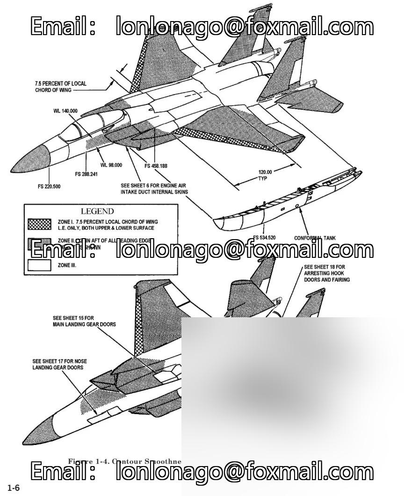
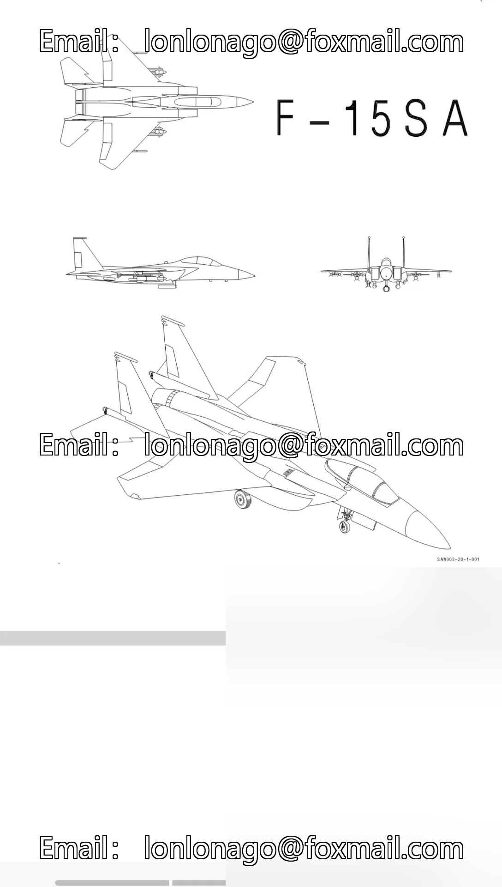
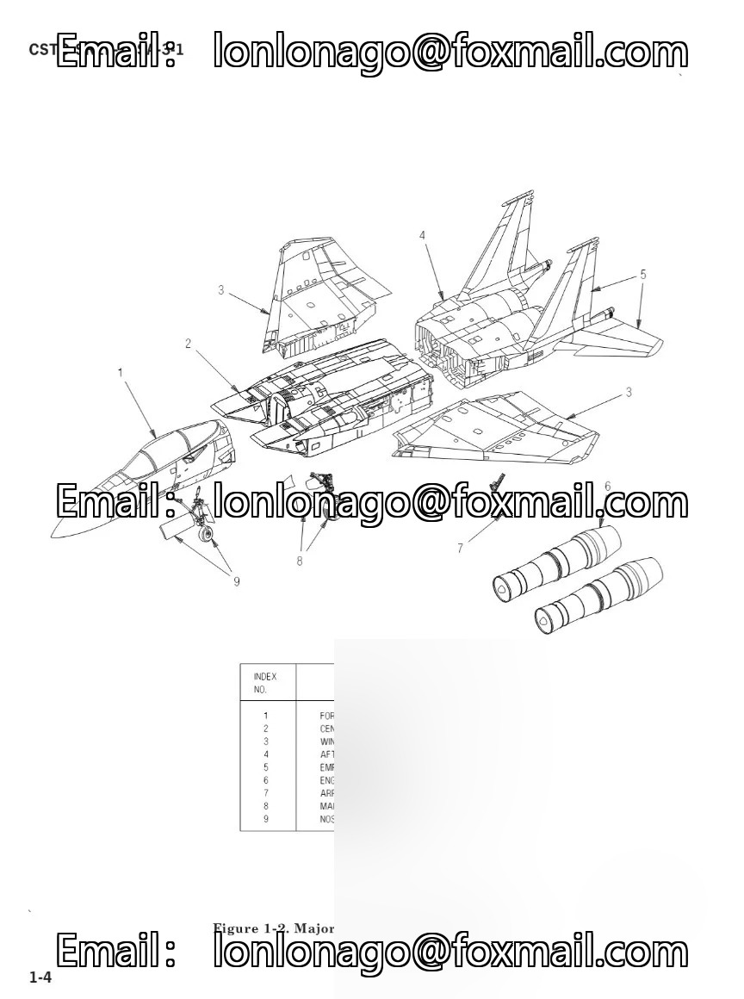
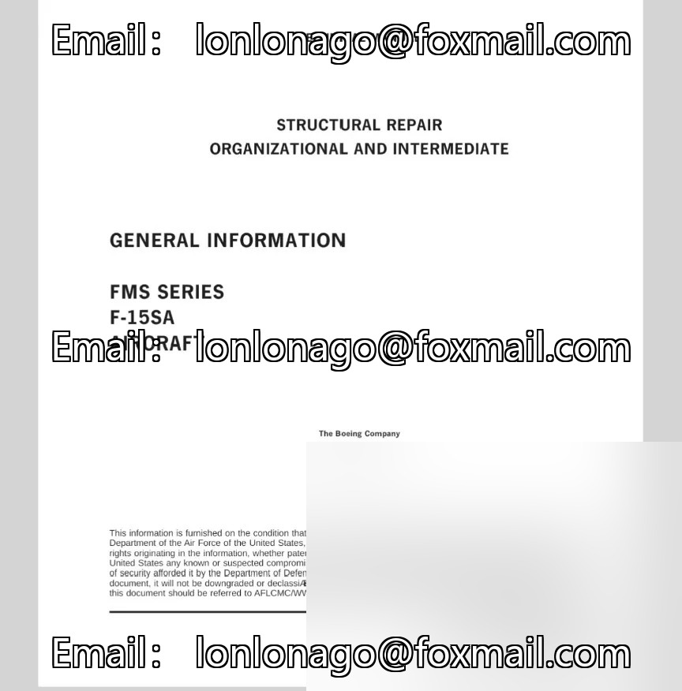
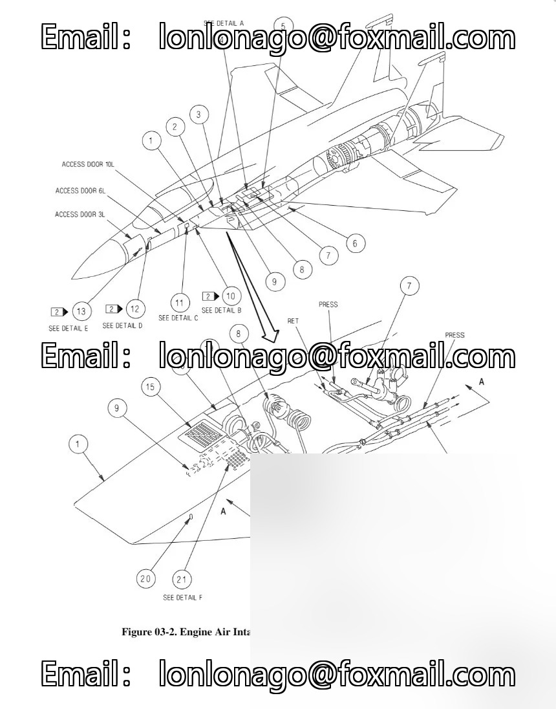
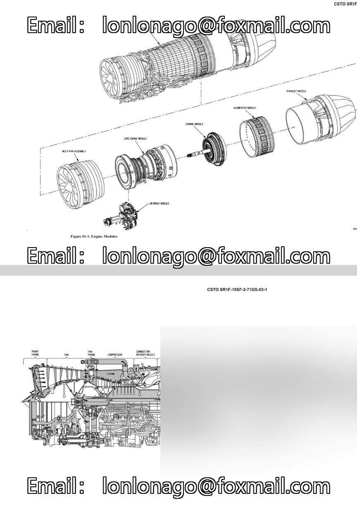
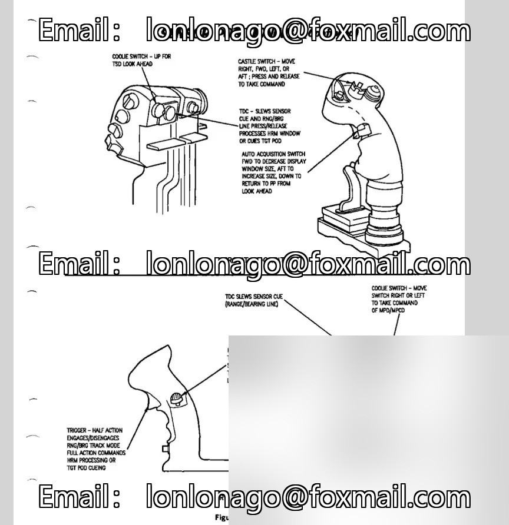
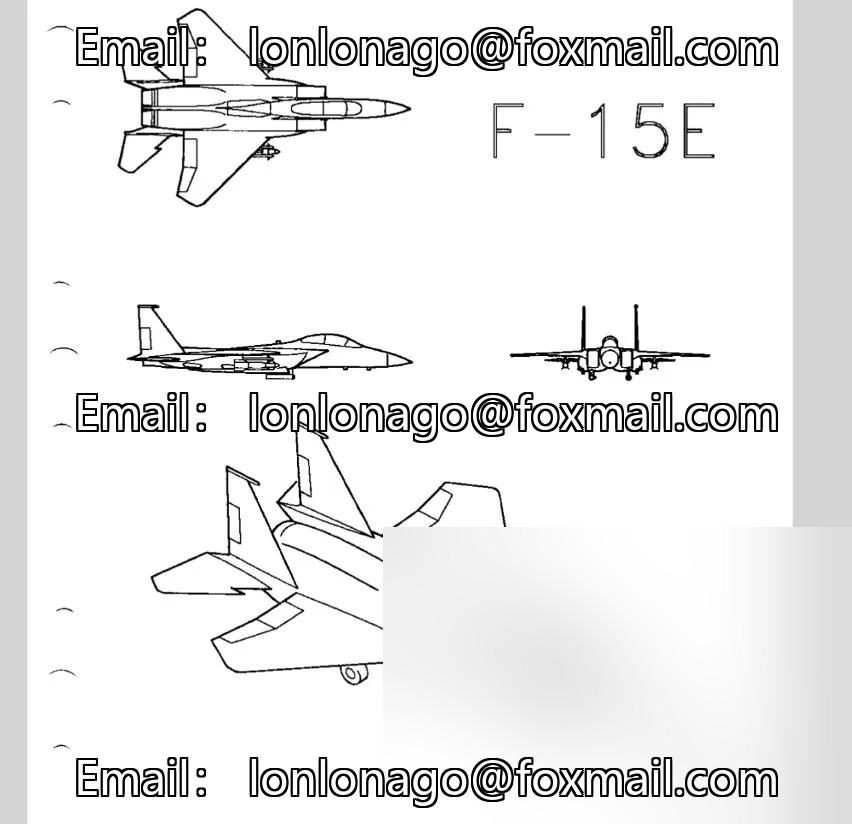
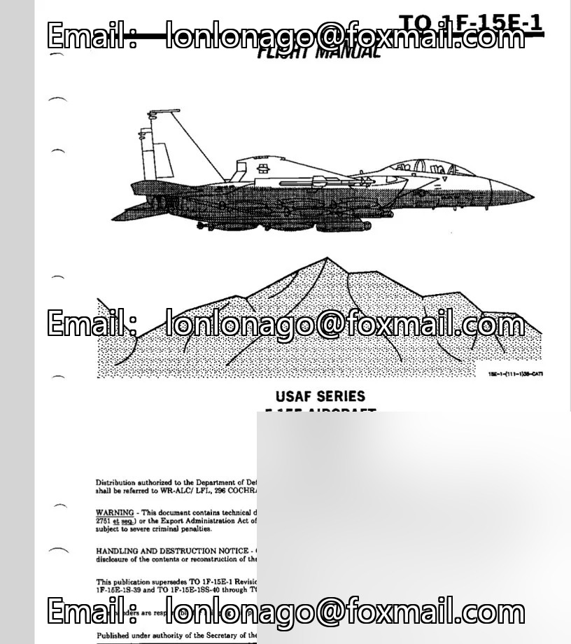

# Official technical manual (5 copies of PDF electronic versions) of the US F-15 fighter series

## Body

Official technical manual for the F-15 series fighters (5 electronic PDF versions)

This set of materials includes five core official technical manuals of the US F-15C/D/E/S/SA series combatants, all in English original version PDF , with a total page count exceeding 3,700 pages, applicable to fields such as aerospace engineering, maintenance and guarantee, flight training, and military technical research.

Manual list and content summary:

"The F-15E Flight Operation Technical Manual" (1993)
An official authorization guide of the U.S. Air Force, comprehensively covering content such as the F-15E aircraft description, normal and emergency operation procedures, crew responsibilities, and flight limitations.

F110-GE-129C Engine Maintenance Technical Manual (2018)
Designed for the F-15SF series fighter jets, it systematically explains the operation principles, maintenance procedures, detailed inspections, fault analysis, and repair guides of key modules such as the power plant, fuel control, ignition system, and air system.

"F-15SA airplane structure maintenance technical manual" (2020)
The official repair guide authorized by the U.S. Air Force and compiled by Boeing covers assessment and repair processes for structural damage, including permanent repair, temporary repair, and combat injury speed repair. It is applicable to organization-level, intermediate-level, and base-level repairs.

"The F-15SA Flight Manual" (2018)
Official technical documents from Boeing Company, applicable to aircraft equipped with the F110-GE-129 engine, covering the aircraft description, normal and emergency operation procedures, crew responsibilities, performance limitations, and air refueling, etc.

(F-15C/D/S Crew Weapon Delivery Manual) (2015)
Standard weapon operation guide for U.S. Air Force F-15 aircraft, systematically explaining air-to-ground/air weapons, fuses, mounting equipment, safety procedures, mission planning, and error analysis, providing an authoritative and comprehensive technical reference for pilots and ground staff personnel.

Features of materials:

Source authority: All are compiled or authorized by official institutions such as the U.S. Air Force and Boeing.

Content system: covers key fields such as flight operations, engine maintenance, structural repair, weapon launch, etc.

High practical value: contains a large number of operation processes, fault handling, and maintenance methods, and has relatively high engineering reference value.

The material includes official technical manuals for the US F-15 series (five PDFs), with visible local ratios, chord lines, scale marks, figure notes and various drawing details.

<!-- AI_ENRICHED -->

## Images

## Payment

Here is a pay link on Stripe ( https://buy.stripe.com/3cs8yP7sY87d0vu9AB ). Please contact me lonlonago@foxmail.com after funding $89, and I will send you a complete data files , thank you!

